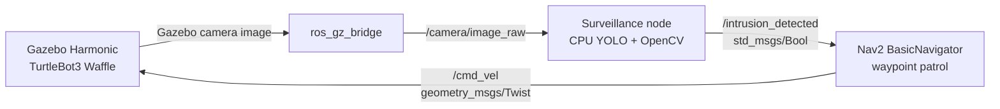

# Autonomous Perimeter Rover

A TurtleBot3 Waffle simulation that follows a Nav2 perimeter route while running CPU-based YOLO surveillance. When a person is detected, waypoint navigation is canceled and resumes after the alert clears.

## Prerequisites

- Ubuntu with ROS 2 Jazzy and Gazebo Harmonic.
- ROS packages used by the launch: `nav2_bringup`, `nav2_simple_commander`, `tf2_ros`, `ros_gz_bridge`, and the message and OpenCV bridge dependencies declared in `src/perimeter_rover/package.xml`.
- `colcon` and `rosdep` for workspace setup.
- Python runtime with `ultralytics`, NumPy, OpenCV, and `cv_bridge` available to ROS nodes.
- YOLO weights at `yolo26n.pt` in this repository root. The surveillance node falls back to `yolov8n.pt` if that file is unavailable.
- A graphical display for the OpenCV camera preview.

Install missing ROS dependencies from the repository root:

```bash
source /opt/ros/jazzy/setup.bash
rosdep install --from-paths src --ignore-src -r -y
```

Install Python inference dependencies into the Python environment used by the ROS nodes if they are not already present.

## Architecture



The unified launch starts Gazebo, Nav2, the camera bridge, surveillance, and patrol. Patrol submits boundary poses to Nav2's `FollowWaypoints` action. A positive `/intrusion_detected` message cancels the active navigation task; the robot pose in the `map` frame is logged, and patrol resumes after the alert clears. The default `slam:=True` builds a map for the selected world instead of reusing an unrelated static map.

## Quick Start

From the repository root:

```bash
source /opt/ros/jazzy/setup.bash
colcon build --symlink-install --packages-select perimeter_rover
source install/setup.bash
ros2 launch perimeter_rover unified_surveillance.launch.py
```

By default, the launch uses the packaged `empty.sdf`. Select the custom perimeter arena with:

```bash
ros2 launch perimeter_rover unified_surveillance.launch.py \
    world:=/home/$USER/autonomous-perimeter-rover/src/perimeter_rover/worlds/perimeter_arena.sdf
```

Any Gazebo SDF or xacro world path can be supplied. For example, on installations containing the Nav2 TurtleBot4 simulation worlds:

```bash
ros2 launch perimeter_rover unified_surveillance.launch.py \
    world:=/opt/ros/jazzy/share/nav2_minimal_tb4_sim/worlds/warehouse.sdf
```

`waypoints` is a flat sequence of `x, y, yaw` triples in the `map` frame; yaw is in radians. Set it to match the selected world. For a prebuilt world map, use `slam:=False map:=/path/to/map.yaml`; set `initial_x`, `initial_y`, and `initial_yaw` to the robot pose in that map. These arguments also set the Gazebo spawn pose.

Stop the simulation with `Ctrl+C` in the launch terminal.
